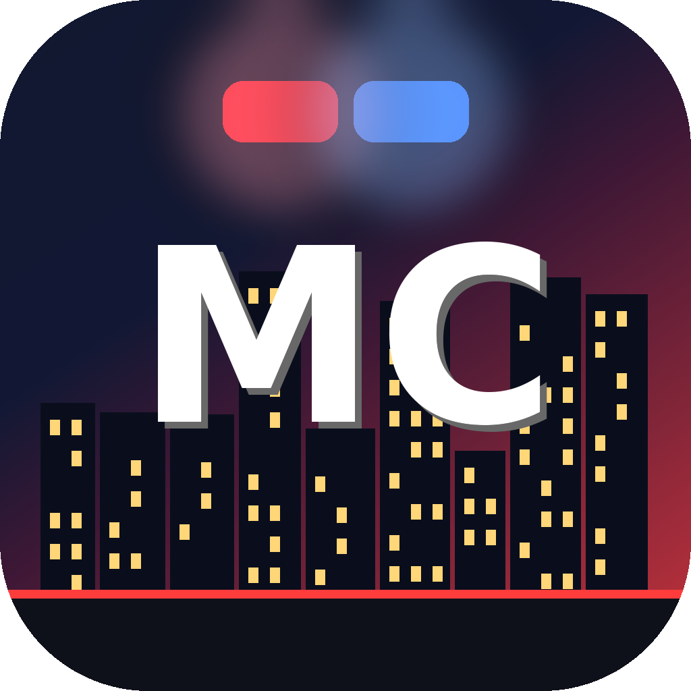

<p align="center"></p>

# MAD CITY 3D — لعبة المدينة المفتوحة

مدينة مفتوحة ضخمة (1.3 كم × 1.3 كم) بثلاثة أدوار: **شرطي · مجرم · مواطن**. كل مبنى فيها له وظيفة حقيقية.
تُبنى بـ Three.js وتعمل في المتصفح أو كبرنامج ويندوز مستقل.

🌐 **الموقع الرسمي:** `docs/` (يُنشر عبر GitHub Pages — انظر أسفل)

## التحميل (ويندوز)
| الملف | الوصف |
|---|---|
| `release/MadCity-Setup.exe` | **المثبّت الرسمي**: معالج عربي، اختيار المجلد، اختصارات، تسجيل في «التطبيقات المثبتة»، وإزالة نظيفة |
| `release/MadCity.exe` | نسخة محمولة بملف واحد |

لا يحتاج صلاحيات مسؤول ولا إنترنت. الملفات غير موقّعة رقمياً فقد يظهر تحذير SmartScreen («مزيد من المعلومات ← تشغيل على أي حال»).
التثبيت الصامت: `MadCity-Setup.exe /S`

## تشغيل الشيفرة
```bash
python3 -m http.server 8000     # ثم افتح http://localhost:8000
./build-exe.sh                  # يبني release/MadCity.exe و MadCity-Setup.exe (Go 1.21+)
./sync-site.sh                  # يحدّث نسخة المتصفح في docs/play
```

## نشر الموقع على GitHub
1. ادمج الفرع في `main` (أو اختر هذا الفرع).
2. **Settings → Pages → Source: GitHub Actions** (يعمل `pages.yml` تلقائياً) — أو *Deploy from a branch* ثم المجلد `/docs`.
3. لنشر إصدار رسمي بالمثبّت: `git tag v1.0.0 && git push --tags` (يبني `build.yml` الملفات ويرفعها في Releases، ويلتقطها الموقع تلقائياً).

## المحتوى
- **مدينة**: وسط أبراج، أحياء سكنية، منطقة صناعية، حدائق، جبال، دورة ليل/نهار ومطر، إشارات مرور.
- **كل مبنى بخدمة**: مطاعم، مقاهي، سوبرماركت، صيدليات، ملابس، نوادٍ، بنوك (إيداع/سحب/سرقة)، مجوهرات (بورصة ذهب)، كازينو، فنادق، شقق ومنازل للبيع، مراكز أعمال، ورش ومرائب، سكراب، مستودعات ومصانع، معارض سيارات، مستشفيات، مراكز شرطة.
- **حياة**: جوع وطاقة وتحمّل، وقود للسيارات، حساب بنكي، منزل ومرآب وخزانة ملابس، وظائف (تاكسي · توصيل · شحن)، خريطة كبيرة بوجهة.
- **جريمة**: سرقة بنك بخزنة داخلية، مثقاب/قفل بيك/قناع، شهود يبلّغون، مطاردات ★1-5 مع حواجز ومسامير ومروحية، سجن وهروب (نفق · سياج · بطاقة حارس).
- **شرطي**: بلاغات حيّة، صاعق، اعتقال، مطاردة سيارات الهروب.
- **سيارات**: فيزياء انزلاق وآثار إطارات، 11 نوعاً (سيدان، SUV، فان، حافلة، إسعاف، ماسل، رياضية، سوبر…)، ضرر وانفجارات.

## التحكم
`WASD` حركة/قيادة · الماوس كاميرا · كليك نار · `Shift` ركض · `Space` قفز/فرامل يد · `E` تفاعل (مطولاً للسرقة) · `F` خدمات المتجر المسروق
`R` تعبئة · `1-4` أسلحة · `Q` إسعاف · `M` خريطة كبيرة (انقر لتحديد وجهة) · `J` إنهاء الوظيفة · `K` إلغاء الوجهة · `H` منبّه · `X` سارينة · `T` مطر · `Esc` إيقاف/جودة

## هيكل المشروع
`index.html` + `js/` (core · world · actors · life · game) · `launcher/` (Go: ملف اللعبة) · `installer/` (Go: المثبّت) · `docs/` (الموقع) · `assets/` (الأيقونة)
